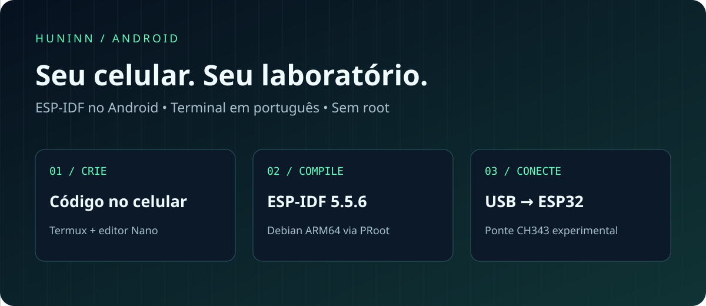
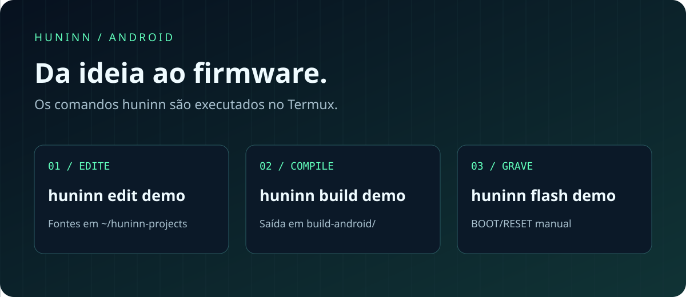
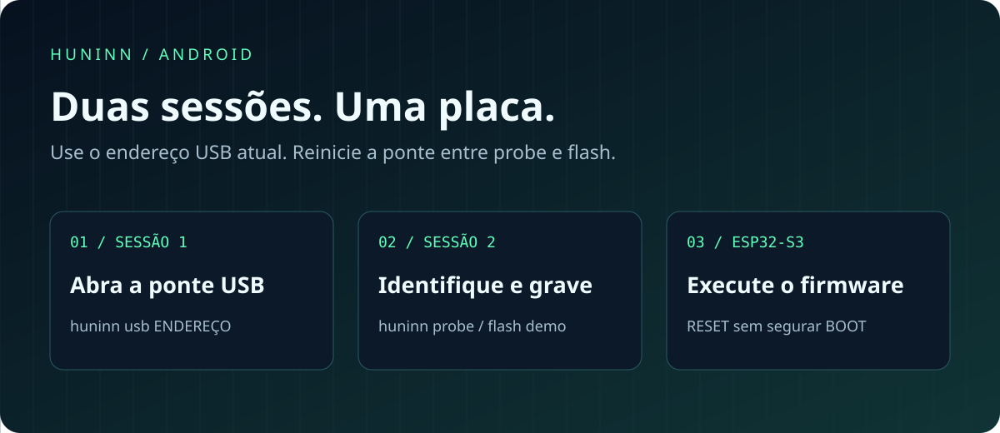
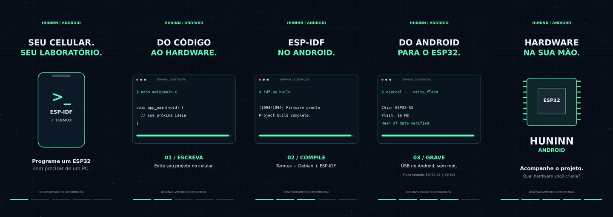

<div align="center">



# HUNINN Android

**Crie, edite, compile e experimente hardware ESP32 pelo celular.**

`v0.1.0 experimental` · `ESP-IDF 5.5.6` · `Android ARM64` · `MIT`

[Começar](#comece-aqui) · [Tutorial USB](#grave-na-placa) · [Comandos](#comandos) · [Baixar o reel](#vídeo-e-material-para-compartilhar)

</div>

Um ambiente de desenvolvimento no Termux, com Debian via PRoot e ferramentas
oficiais do ESP-IDF. O projeto tem interface de terminal em português: **não é
um APK nem uma distribuição oficial da Espressif**.

> **Estado atual:** o fluxo original de compilação e gravação foi testado em
> Android com ESP32-S3 + CH343. O instalador independente ainda precisa de
> validação completa em um Android físico. Veja [validação e limites](#validação-e-limites).

## O que você pode fazer

| No celular | Com HUNINN |
| :--- | :--- |
| Criar um projeto | Template ESP-IDF, sem acionar pinos desconhecidos |
| Escrever código | Nano e arquivos C no armazenamento privado do Termux |
| Configurar a placa | menuconfig para flash, PSRAM e opções do firmware |
| Compilar e exportar | Firmware local, relatório de tamanho e binário combinado |
| Gravar via USB | Ponte experimental CH343, com identificação e confirmação |
| Reaproveitar o SDK | Opção para quem já tem o ambiente `huninn-idf` |



## Comece aqui

### 1. Prepare o Android

- Instale [Termux](https://f-droid.org/packages/com.termux/) e, para USB,
  [Termux:API](https://f-droid.org/packages/com.termux.api/) **da mesma fonte**.
  O aplicativo Termux:API é necessário além do pacote instalado no terminal.
- Use Android **ARM64**. `uname -m` e `dpkg --print-architecture` devem indicar `aarch64`.
- Separe pelo menos **10 GiB livres**; recomendamos 12–15 GiB para SDK e builds.
  Reutilizar o SDK antigo exige pelo menos 2 GiB adicionais.
- Tenha internet durante a instalação. O Wi-Fi local da station pode não ter internet.
- Para gravar, use cabo **de dados/OTG** e uma interface USB compatível.

**Compatibilidade da versão atual**

| Recurso | Suporte |
| :--- | :--- |
| Projetos ESP32 / S3 / C3 / C6 | Aceitos pelo CLI; demais combinações ainda sem teste físico |
| Gravação ESP32-S3 + CH343 `1a86:55d3` | Fluxo original testado |
| CP210x, CH340, FTDI e USB nativa Espressif | Não implementados nesta ponte |
| Root ou computador Windows | Não necessários para o fluxo compatível |

### 2. Baixe o projeto

No **Termux**, execute:

```bash
pkg update
pkg install git
git clone https://github.com/duOCELOT/hunnin-android.git ~/huninn-android
cd ~/huninn-android
```

O repositório se chama **hunnin-android**. A pasta sugerida e o comando usam
**huninn**. Se a pasta já existir, não clone por cima dos seus arquivos.

<details>
<summary><strong>Alternativa: baixar ZIP pelo navegador, sem login no terminal</strong></summary>

Abra o [ZIP do projeto](https://github.com/duOCELOT/hunnin-android/archive/refs/heads/main.zip).
Se o repositório estiver privado, entre no GitHub pelo navegador primeiro.

```bash
pkg update
pkg install unzip
termux-setup-storage
unzip ~/storage/downloads/hunnin-android-main.zip -d ~
cd ~/hunnin-android-main
```

Aceite a permissão de armazenamento do Android. Preserve a pasta existente antes
de extrair outra cópia. A instalação deve ficar na pasta privada do Termux,
**não dentro de Downloads**.

</details>

### 3. Instale — escolha um caminho

**Primeira instalação:**

```bash
bash install.sh --check
bash install.sh
huninn doctor
```

**Já tem o SDK do projeto HUNINN (`huninn-idf`)?** Use este bloco no lugar do anterior:

```bash
bash install.sh --reuse-huninn-idf --check
bash install.sh --reuse-huninn-idf
huninn doctor
```

A reutilização preserva o comando antigo `huninn-idf` e seus projetos. O novo
comando é **`huninn`**. Nas próximas execuções do instalador, mantenha a mesma
opção de reutilização.

A instalação baixa compiladores e dependências; o tempo depende do aparelho e
da rede. Mantenha o Termux em primeiro plano. `huninn` só fica disponível quando
a instalação termina. Em caso de interrupção, corrija o erro e execute o mesmo
instalador novamente: não precisa apagar todo o SDK.

**Mantenha a pasta do instalador no lugar.** Se movê-la, execute a instalação
novamente para atualizar os caminhos do comando.

## Seu primeiro firmware

### 4. Crie e edite

```bash
huninn new demo --chip esp32s3
huninn edit demo
```

O arquivo fica em `~/huninn-projects/demo/main/main.c`. O exemplo envia uma
mensagem pela UART a cada dois segundos e não aciona GPIOs.

No Nano: **Ctrl+O → Enter** salva; **Ctrl+X** sai. Use a tecla Ctrl da barra extra
do Termux ou Volume para baixo como modificador.

### 5. Configure e compile

```bash
huninn config demo
huninn build demo
huninn size demo
```

Confira o **tamanho real da flash**, modo e PSRAM da sua placa. O template usa
padrões do ESP-IDF, incluindo flash de 2 MB; não presume que toda placa tem 16 MB.
Ao concluir, procure **`Project build complete`**. Os arquivos ficam em
`~/huninn-projects/demo/build-android/`.

Os comandos acima rodam no Termux. Para comandos `idf.py` manuais, entre primeiro
com `huninn shell demo` e use `idf.py -B build-android ...`. Saia com `exit`.
Não reutilize builds do Windows nem execute `set-target` apenas para mudar de computador.

## Grave na placa



### 6. Identifique o USB

Conecte a placa pela porta **USB-UART** e execute no Termux:

```bash
huninn usb-list
huninn usb-info /dev/bus/usb/001/002
```

**Substitua o endereço de exemplo pelo que apareceu na sua lista.** Aceite a
permissão USB do Android. Esta ponte requer VID/PID **`1a86:55d3`**.

### 7. Abra a ponte e confira a flash

Segure **BOOT**, pressione e solte **RESET**, depois solte **BOOT**. Confira
`huninn usb-list` novamente: o endereço pode mudar.

Na **sessão 1** do Termux:

```bash
huninn usb /dev/bus/usb/001/002
```

Espere **`CH343 ready`** e mantenha essa sessão aberta. Crie uma segunda sessão
pelo menu lateral do Termux e, na **sessão 2**, execute:

```bash
huninn probe demo
```

Esse comando identifica chip e flash sem gravar. Compare o resultado com a
configuração do projeto; se ajustar `huninn config demo`, compile novamente.

### 8. Grave e execute

A ponte atende **uma conexão por execução**. Depois do `probe`, execute novamente
`huninn usb ENDEREÇO` na sessão 1. Na sessão 2:

```bash
huninn flash demo
```

Confira o resumo e digite **`demo`** quando solicitado. Espere a verificação dos
hashes de todos os segmentos. Depois pressione **RESET sem BOOT** para iniciar
o firmware. A compilação, sozinha, não altera o programa na placa.

A ponte aguarda até 180 segundos por conexão e mantém 115200 baud. Consulte o
[tutorial USB completo](docs/usb.md) para detalhes e diagnóstico.

## Se algo não funcionar

| Mensagem ou situação | O que fazer |
| :--- | :--- |
| `huninn: command not found` | A instalação não terminou; examine o erro anterior e retome o instalador. |
| `Could not resolve host` | Confira a internet; saia do Wi-Fi da station se ele não oferece internet. |
| `Connection refused` | Reinicie a ponte na sessão 1 antes do próximo comando. |
| `No such device` | Rode `huninn usb-list` e use o endereço atual. |
| `No serial data received` | Confira BOOT/RESET, USB-UART e a mensagem da ponte. |
| `Device or resource busy` | Feche outro app ou ponte que esteja usando a interface; veja o diagnóstico USB. |
| Android encerra a compilação | Confira espaço, memória e restrições de bateria; veja como reduzir jobs. |

[Guia de recuperação](docs/troubleshooting.md) · [Diagnóstico USB](docs/usb.md#interpretar-erros)

## Vídeo e material para compartilhar

Reel vertical de **25 segundos, 1080 × 1920**, com textos em português e trilha
sintetizada original. Os terminais são ilustrações do fluxo, não uma captura de tela.

[](media/huninn-android-reel.mp4)

**[Baixar vídeo MP4](https://github.com/duOCELOT/hunnin-android/raw/refs/heads/main/media/huninn-android-reel.mp4)**
· [Capa JPG](https://github.com/duOCELOT/hunnin-android/raw/refs/heads/main/media/capa.jpg)
· [Legenda para copiar](media/legenda.txt)

No celular, se o vídeo abrir no navegador, use **Baixar** no player ou o menu
**⋮ → Download**. Também é possível abrir [o arquivo no GitHub](media/huninn-android-reel.mp4)
e selecionar **Download raw file**. Se o repositório estiver privado, faça login
no navegador. O [ZIP do repositório](https://github.com/duOCELOT/hunnin-android/archive/refs/heads/main.zip)
também inclui os três arquivos na pasta `media/`.

## Comandos

| Comando | Função |
|---|---|
| `huninn doctor` | Verificar SDK e compilador |
| `huninn list` | Listar projetos |
| `huninn new NOME --chip esp32s3` | Criar um projeto novo |
| `huninn edit NOME` | Editar `main/main.c` no Nano |
| `huninn config NOME` | Abrir menuconfig |
| `huninn build NOME` | Compilar |
| `huninn size NOME` | Relatório de tamanho |
| `huninn export NOME` | Gerar `build-android/merged-binary.bin` |
| `huninn shell [NOME]` | Terminal Debian com ESP-IDF |
| `huninn usb-list` | Listar dispositivos Android USB |
| `huninn usb-info ENDEREÇO` | Ler VID/PID sem gravar |
| `huninn usb ENDEREÇO` | Abrir ponte CH343 local |
| `huninn probe NOME` | Identificar chip e flash através da ponte |
| `huninn flash NOME` | Gravar build após confirmação |

O arquivo merged é gravado em 0x0 por ferramenta compatível e contém preenchimento
entre segmentos; pode sobrescrever NVS. O comando `huninn flash` usa segmentos
individuais e não executa `erase_flash`. Mudanças de partição ainda podem afetar
os dados antigos. A configuração de placa e o conteúdo do seu firmware continuam
sendo responsabilidade do projeto.

## Validação e limites

- 26 testes automatizados de instalador simulado, criação de projetos, argumentos
  de gravação, recuperação conservadora de checkout e transporte USB simulado.
- O exemplo ESP32-S3 foi compilado com ESP-IDF 5.5.6 no ambiente Linux de validação.
- No projeto de origem, o usuário instalou ESP-IDF 5.5.6 e compilou no Android;
  identificou ESP32-S3/8 MB PSRAM/16 MB flash via CH343 e gravou bootloader,
  aplicativo e partições com hashes verificados. Este é o fundamento da ponte.
- **O instalador independente desta edição ainda precisa de teste completo em
  um Android físico.** Não confundir o fluxo original validado com esta nova embalagem.
- O CLI não é IDE gráfica, não sincroniza contas e não sobe seu código para a nuvem.

Veja [solução de problemas](docs/troubleshooting.md), [roteiro de evolução](docs/roadmap.md)
e [contribuição](CONTRIBUTING.md). A licença do código deste pacote é MIT; cada
ferramenta e dependência baixada mantém sua própria licença.
